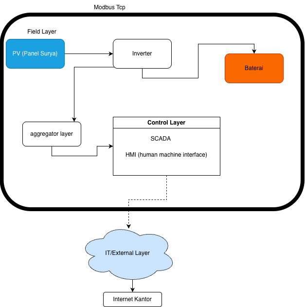

# Arsitektur PLTS & Analisis Keamanan (Trust Boundary)

## 1. Diagram Arsitektur

## 2. Alur Data (Data Flow)
Arsitektur ini mengikuti standar industri untuk Pembangkit Listrik Tenaga Surya (PLTS):
1. **Field Layer (PV Panel)**: Menghasilkan energi listrik DC.
2. **Conversion & Data Layer (Inverter)**: Mengubah DC menjadi AC, sekaligus menghasilkan data digital (suhu, daya, status) yang terekspos via Modbus TCP.
3. **Aggregation Layer (Data Logger)**: Mengumpulkan data digital dari satu atau banyak inverter.
4. **Control Layer (SCADA/HMI)**: Menerima data dari aggregator untuk monitoring dan kontrol lokal.

## 3. Analisis Keamanan: Garis Kepercayaan (Trust Boundary)
Garis merah pada diagram memisahkan **Zona OT (Operational Technology)** dari **Zona IT/Internet**. 

### Aturan Arus Data (Data Flow Policy):
- **BOLEH LEWAT (OT → IT)**: Hanya data *read-only* untuk keperluan monitoring (suhu, daya, status, log alarm).
- **HARUS DIBLOKIR (IT → OT)**: Semua perintah *write* (mengubah setpoint, mematikan inverter, kontrol katup). 

## 4. Titik Rentan & Mitigasi
- **Titik Terlemah**: SCADA, karena sering menjadi jembatan antara OT dan IT.
- **Mitigasi**: Menempatkan Firewall Industri dan sistem Deteksi Anomali di titik perbatasan (garis merah) untuk memastikan tidak ada perintah kontrol yang masuk dari jaringan eksternal.